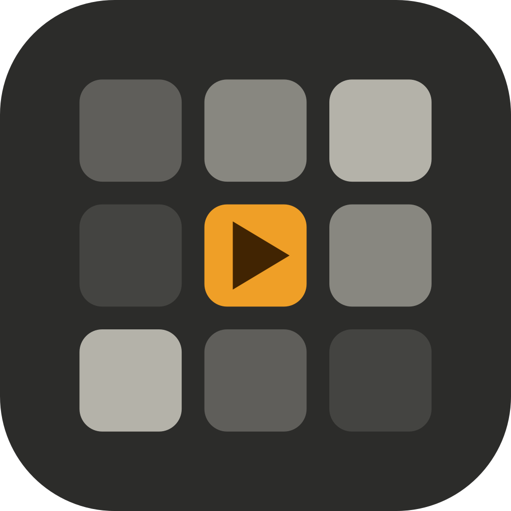
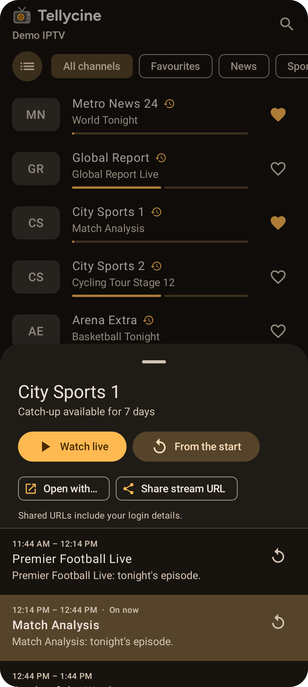
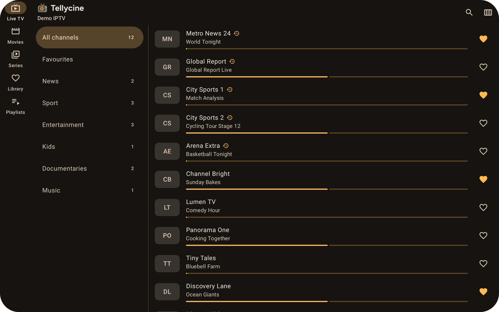

<p align="center">
  
</p>

<h1 align="center">
  <picture>
    <source media="(prefers-color-scheme: dark)" srcset="branding/tellycine-logo-dark.svg">
    
  </picture>
</h1>

<p align="center">
  An IPTV player for Android phones, tablets and TVs, built with Jetpack Compose and Material 3.
  <br><br>
  <a href="https://github.com/harborsyntax/tellycine/releases/latest"><b>Download the latest APK</b></a>
  &nbsp;·&nbsp;
  <a href="docs/Home.md"><b>Documentation</b></a>
</p>

<p align="center">
  
  
  
  
</p>

Tellycine is a player only. It doesn't provide any channels or content; you add playlists from your own provider.

## Features

- **Your sources:** M3U/M3U8 links, local M3U files, Xtream Codes accounts and Dispatcharr servers, with as many playlists as you like.
- **Live TV with a TV guide:** XMLTV guides, "on now" with progress, and a full schedule for each channel.
- **Catch-up TV:** replay past programmes, or restart the current one. Works with Xtream timeshift and M3U `catchup` attributes.
- **Movies & series:** poster grids, details, seasons and episodes, and resume where you left off.
- **Search:** find channels, programmes in the TV guide, movies and series in one place.
- **Downloads:** save movies and episodes to watch offline, with a screen to manage them and a Wi-Fi only option.
- **Library:** favourites, continue watching and recently watched, with sorting and grouping by category.
- **Your choice of content:** hide categories per playlist, or turn off movies & series entirely.
- **A capable player:** HLS, MPEG-TS, DASH and MP4, audio and subtitle tracks, channel switching, and picture-in-picture.
- **Chromecast**, plus **Open with…** any external player, or set one as your default.
- **Dispatcharr:** DVR recordings (watch, schedule and delete), and sharing Dispatcharr or source stream URLs.
- **Built for big playlists:** stream-parsed imports and paged lists keep huge playlists and guides fast.
- **Material 3 design:** Material You colours, light and dark themes, and layouts that adapt to phones, tablets and foldables.
- **Android TV & Google TV:** a full TV interface for the remote, with a traditional grid guide, channel switching and number entry, voice search, and adding playlists from your phone with a QR code. Same app, same APK.

<p align="center">
  
</p>

<p align="center">
  
</p>

## Documentation

See the **[documentation](docs/Home.md)** for installation, adding playlists, catch-up, Chromecast, Dispatcharr, [Android TV](docs/Android-TV.md), troubleshooting and developer notes.

## Building

```bash
./gradlew :core:test :app:assembleDebug
```

Requires JDK 17 and the Android SDK. See [Development](docs/Development.md) for architecture, releases and signing.
