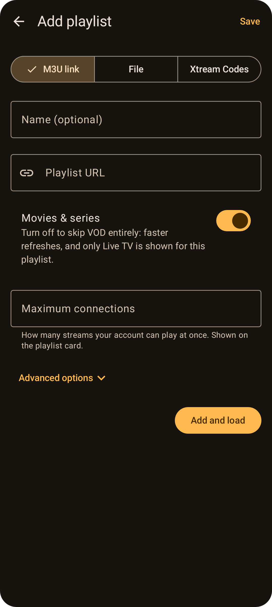

# Adding playlists

Go to the **Playlists** tab and tap **Add playlist**. You can add as many playlists as you like.

Choose the type at the top:

| Type | Use it when you have… |
| --- | --- |
| **M3U link** | a playlist URL (`.m3u` / `.m3u8`), e.g. `http://example.com/playlist.m3u` |
| **File** | an M3U file saved on your device |
| **Xtream Codes** | a server address, username and password from your provider |

**Name** is optional. If you leave it blank, Tellycine uses the server's host name or the file name.

## M3U link
Paste the playlist URL.
- **Xtream link detection:** if it's an Xtream-style `get.php?username=…&password=…` link, Tellycine offers to switch to **Xtream Codes**. Do it: you get movie and series details, seasons and episodes, and catch-up.
- **Dispatcharr links:** if it's a Dispatcharr `…/output/m3u` link, Tellycine suggests using your Dispatcharr Xtream login instead. See [Dispatcharr](Dispatcharr.md).

## File
Tap **Choose .m3u / .m3u8 file** and pick the file. Tellycine keeps permission to re-read it when you refresh the playlist.

## Xtream Codes
Enter the **Server**, **Username** and **Password**.
- **Server format:** something like `http://example.com:8080`. If you paste a longer URL, such as one ending in `/player_api.php`, Tellycine trims it.
- **Account details:** after the first load, the playlist card shows the account's expiry date and how many connections it allows. Dispatcharr accounts don't show an expiry, because Dispatcharr only reports a placeholder.

## Maximum connections
How many streams the account can play at once (most providers allow one or two). It's shown on the playlist card, so you know whether watching on another device, or downloading while you watch, will hit the limit.
- **Xtream Codes:** filled in automatically from your account. Enter a number only to override it.
- **M3U playlists:** providers don't report it, so enter it yourself if you know it.

## Movies & series
Turn **Movies & series** off if you only want live TV. Tellycine then skips downloading VOD entirely: refreshes are faster, storage is smaller, and the Movies and Series tabs are hidden while this playlist is active.

## Advanced options
- **XMLTV guide URL:** the TV guide to use.
  - **When empty:** Tellycine uses the guide named in the M3U file (`url-tvg` / `x-tvg-url`), or the provider's guide for Xtream accounts.
  - **Several guides:** separate them with commas.
  - **Compressed guides:** `.xml.gz` files are supported.
- **User agent:** how Tellycine identifies itself to your provider. Some providers only serve streams to apps they recognise.
  - **Default (VLC):** Tellycine identifies itself as VLC, which most providers accept.
  - **Presets:** TiviMate, IPTV Smarters Pro, OTT Navigator, Perfect Player, Kodi, MX Player, ExoPlayer, FFmpeg, Chrome on Android, or a Samsung smart TV. Pick the app your provider supports.
  - **Custom…:** type any user agent. It starts from the preset you had selected, so you can tweak it.
  - The user agent is used for the playlist, guide, playback and downloads.

## What happens next
Tap **Add and load**. Tellycine downloads the playlist and then the TV guide, showing progress on the playlist card and in a thin bar under the top bar. Even very large playlists (hundreds of thousands of entries) and guides are streamed straight into the database, so the app stays responsive.

See also: [Managing playlists](Managing-Playlists.md).
