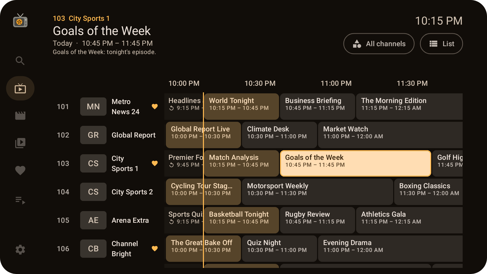
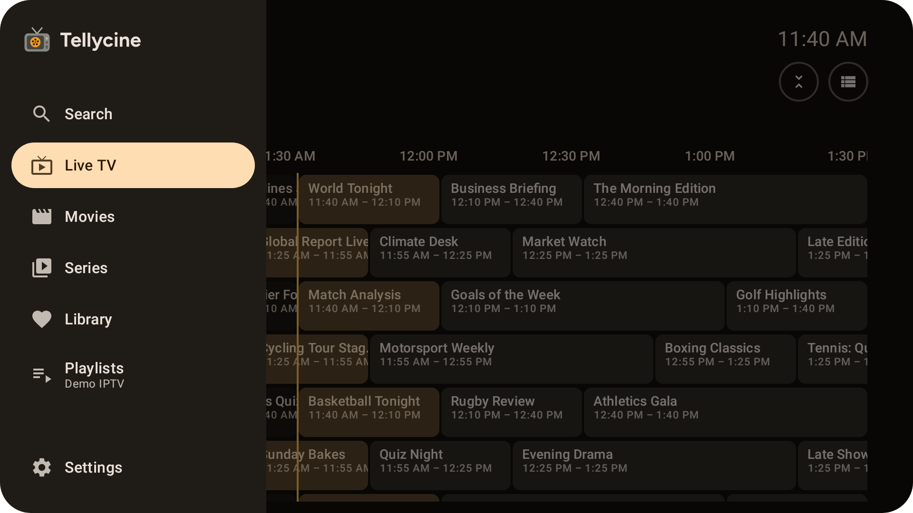
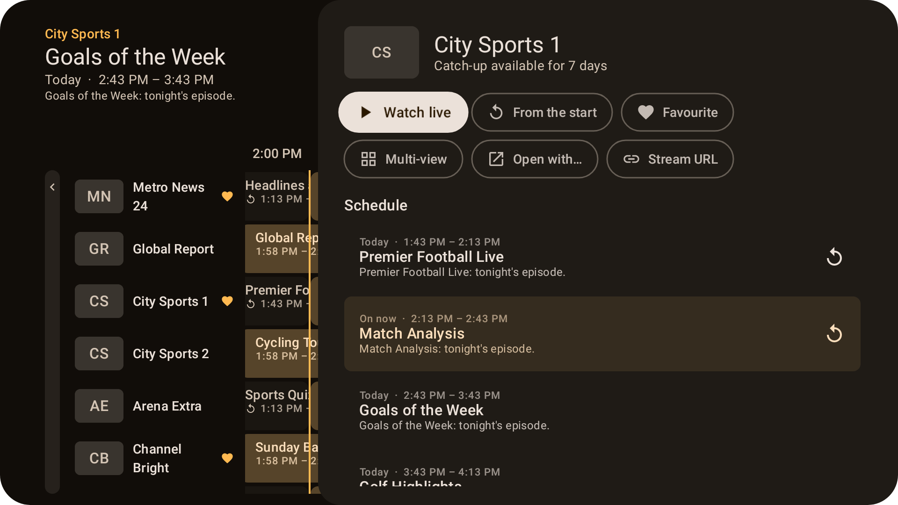
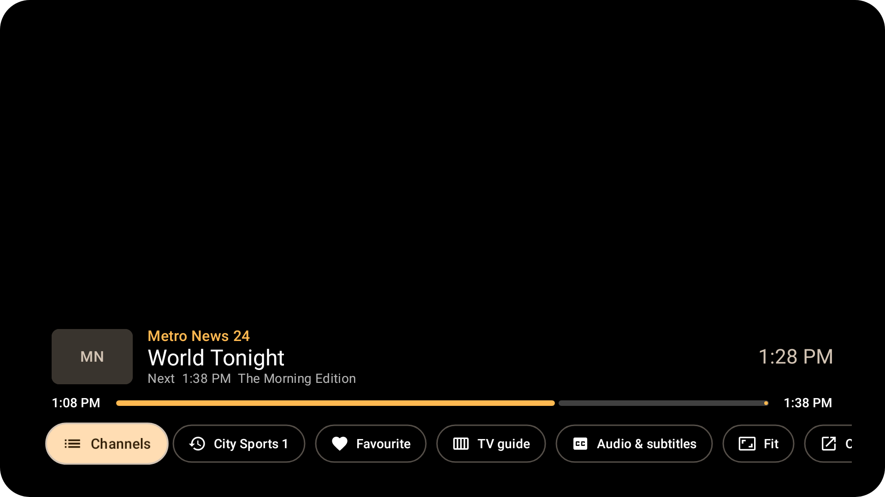
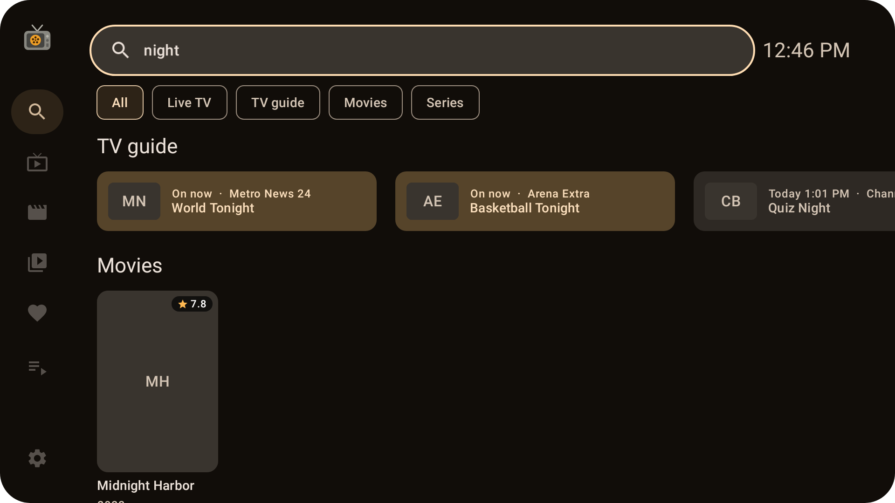
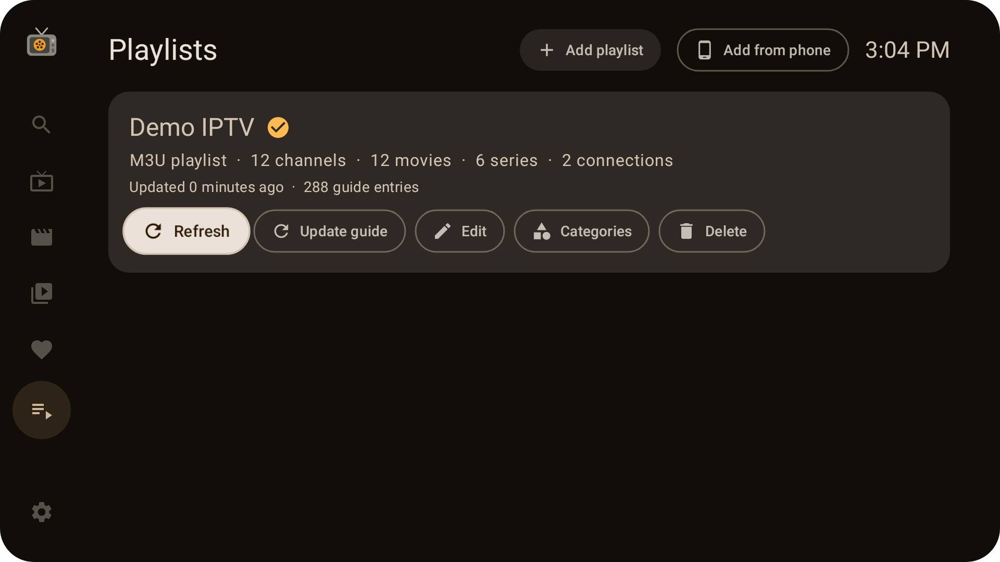

# Android TV & Google TV



Tellycine has a full TV interface, made for the remote. It's the same app (the same APK) as on phones and tablets: on a TV it appears in the launcher with its own banner and opens the TV interface. Everything the phone app does is there, apart from Chromecast (the TV is already the screen).

## Installing on a TV
Tellycine isn't on the Play Store, so it's installed from GitHub.

**With the Downloader app** (the easiest way on Google TV and Fire TV):
1. Install **Downloader** (by AFTVnews) from the Play Store on your TV.
2. Allow it to install apps: **Settings → Apps → Security & restrictions → Unknown sources → Downloader**. On some Google TV devices this setting only appears once developer options are on: **Settings → System → About**, then press **Android TV OS build** seven times.
3. In Downloader, enter this address. It always points to the latest version:

   ```
   github.com/harborsyntax/tellycine/releases/latest/download/tellycine.apk
   ```
4. Choose **Install** when the download finishes.

**Other ways:** send the APK from your phone with an app such as *Send Files to TV*, or with `adb install tellycine-vX.Y.Z.apk` from a computer.

Updates install the same way, over the existing app.

### Which TVs
- **Android TV and Google TV:** Google TV Streamer, Chromecast with Google TV, Nvidia Shield, and TVs with Google TV or Android TV built in. Android 8.0 or newer.
- **Fire TV:** Fire TV devices that run Fire OS (Android) work. Amazon's newer **Vega OS** devices (starting with the Fire TV Stick 4K Select) can't run Android apps, so Tellycine can't be installed on them.

## Getting around
- The **side menu** (Search, Live TV, Movies, Series, Library, Playlists, Settings) is on the left. Press **Back** from any screen to open it, and **Back** again to leave Tellycine.
- **OK** chooses. **Hold OK** for more options: a channel's schedule and actions, removing a Library item, or deleting a download or recording.
- Everything works with just the arrows, OK and Back, so any remote will do. Number and channel buttons are used when your remote has them.



## Live TV
Live TV opens on the **guide**: channels down the side and time across the top.

| Press | To |
| --- | --- |
| Up / Down | Move between channels. **CH+ / CH−** move a page at a time. |
| Right / Left | Move through programmes. Left goes back in time, for catch-up. Keep pressing Left to reach the channel itself. |
| Left (on a channel) | Open the **categories**: the faded column to the left of the channels. Up/Down choose one and OK shows its channels; Right or Back return without changing. |
| OK | Watch what's on now, replay a past programme, or see the schedule for an upcoming one. |
| Hold OK (or Menu) | The channel's **options and schedule**: watch live, watch from the start, favourite, open in another app, show the stream URL, and replay or record programmes. |
| Up (from the first channel) | Reach the **category** (which also opens the column), **Compact** and **List** buttons. |

The top of the screen describes the highlighted programme. **Compact** shrinks the rows to fit more channels on screen; **Expand** makes them bigger again. **List** switches to a plain channel list with what's on now; **Guide** switches back.

When you go back to the guide from a live channel, it keeps playing in a **mini player** in the top corner. Press OK on the mini player, or **hold Back** anywhere in the guide, to return to it full screen. It stops when you leave the guide.



Stream URLs are shown as a **QR code**: scan it with your phone to open or copy the link. Like on the phone, shared URLs include your login details.

## Watching


| Press | Live TV | Movies and episodes |
| --- | --- | --- |
| Up / Down, CH+ / CH− | Next / previous channel | Show the controls |
| Left / Right | Channel list | Back 10 seconds / forward 30 seconds |
| OK | Show the controls | Show the controls |
| Number keys | Go to that channel number | |
| Play/Pause, Rewind, Fast forward | | As labelled |
| Info | Show what's on now and next | Show progress |
| Menu or Captions | Audio & subtitles | Audio & subtitles |
| Back | Close the controls, then return to the guide (the channel keeps playing in the mini player) | Close the controls, then stop |

The controls include **Channels**, the **channel you were watching before** (one press to flip back), **favourite**, **TV guide**, **audio & subtitles**, **aspect ratio**, **Open with…**, **picture-in-picture** (on TVs that support it) and **Stats for nerds**.

- **TV guide** shows the guide over the lower part of the picture, so the channel keeps playing while you look. It opens on the channel you're watching, in its category. The categories are a faded column on the left: press **Left** from the channel names to open it, and OK on a category to show its channels (Right or Back returns without changing). OK on a programme on now changes channel; OK on a past one replays it, where the provider offers catch-up. Back closes it.
- **Stats for nerds** shows the stream's formats, HDR and colour information, decoders, download rate, buffer, dropped frames and the TV's display mode, updated every second. Press it again to hide them.

## Movies, series and the Library
- **Movies** and **Series** are poster grids. Press **Left** from the first column for the categories.
- A title's page has **Play** or **Resume**, **From the beginning**, **Add to favourites** and **Download**. For series, choose a season, then an episode; hold OK on an episode to download it or play it from the beginning.
- **Library** has rows for continue watching, recently watched channels and favourites, with **Clear all** and **Sort**. Hold OK on an item to remove it.

## Search
Press OK on the search box to type with the on-screen keyboard, or choose **Voice** to speak. Results are grouped into channels, the TV guide, movies and series.



## Adding a playlist
Typing long addresses and passwords with a remote is slow, so there are two ways:

- **Add from phone** (on the Playlists screen): the TV shows a QR code. Scan it with your phone, which must be on the same Wi-Fi, and fill in the playlist on the page that opens: an Xtream or Dispatcharr login, an M3U link, or a playlist file from your phone. It's added to the TV straight away. The page only works while that screen is open on the TV, and only with the code it shows.
- **Add playlist:** a form where each field opens the keyboard when you press OK.

Many TVs don't have a file picker. If **Playlist file** says there's no way to choose a file, use **Add from phone** to send the file instead.



## TV settings
These settings are only on TV:
- **Theme:** the TV interface's colours, all dark for the big screen. **Warm** (amber on dark brown, the original look), **Midnight** (cool white and sky blue on blue-black), **Graphite** (pure white and teal on neutral grey), **Forest** (soft green on deep green) or **High contrast** (white and yellow on black, easiest to read from across the room). A theme applies as soon as you pick it.
- **Open on the last channel:** start playing the channel you watched last when Tellycine opens.
- **Match the TV's refresh rate:** switch the display to suit each video (50 Hz for UK and European channels, 24 Hz for films) so motion is smooth. The screen may go blank for a moment when it switches. It only applies when the stream reports its frame rate. Google TV also has its own **Match content frame rate** setting under *Display & sound → Advanced display settings*.

All the other [settings](Settings.md) work as on the phone.
