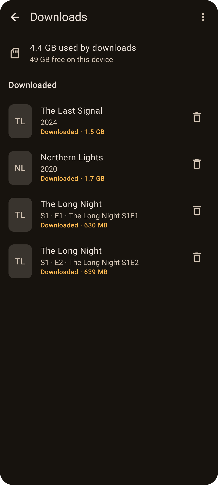

# Downloads

Save movies and episodes to your phone or tablet and watch them without a connection: on a plane, on the underground, or anywhere your signal drops.

## Downloading
- **Movies:** open the movie and tap the **download** button next to the heart.
- **Episodes:** open the series and tap the **download** button on any episode.

The download runs in the background, even if you close Tellycine, with a progress notification from Android. On the details page:

| Button | Meaning | Tap to |
| --- | --- | --- |
| Download arrow | Not downloaded | Start downloading |
| Progress ring with **×** | Downloading or waiting | Cancel |
| Tick | Downloaded | Delete the download |
| Red **!** | Failed, or the file has gone missing | Try again |

A line under the buttons (or under the episode name) shows progress, size, or why a download is waiting.

## Watching downloads
Just press **Play** as usual. When a title is downloaded, Tellycine plays the copy on your device, in the built-in player, and keeps your resume point in step with streaming. You can also play downloads from **Library → Downloads**.

While you're casting, Chromecast streams the title from your provider, because the TV can't read files on your phone.

## Managing downloads
Open **Library → Downloads**, or **Settings → Manage downloads**.
- **Storage:** how much space downloads use, and how much is free.
- **In progress:** downloads that are running, waiting or failed, with progress bars. Tap **×** to cancel, or **↻** to retry a failed one.
- **Downloaded:** tap a title to play it, or the bin to delete it.
- **Delete all downloads:** in the **⋮** menu.

Deleting a download only removes the file from your device. The title stays in your playlist, so you can still stream it.

## Wi-Fi only
**Settings → Download over Wi-Fi only** is on by default. Downloads wait for Wi-Fi (or another unmetered connection) and show **Waiting for Wi-Fi** until then. Turn it off to download over mobile data too. The setting applies to new downloads.

## What can be downloaded
- Movies and episodes that your provider serves as video files: MP4, MKV, TS and similar. This covers Xtream Codes and Dispatcharr VOD, and most M3U playlists.
- Not live channels, catch-up, or titles your provider only offers as HLS (`.m3u8`) or DASH streams. Tellycine tells you if a title can't be downloaded.

## Good to know
- **Storage:** downloads are saved in Tellycine's own storage on the device, so they need no storage permission. They aren't included in Android backups. **They're deleted if you uninstall Tellycine.**
- **Connection limits:** many providers allow only one or two connections at a time. A download counts as one, so watching live TV while downloading can hit the limit.
- **Playlist changes:** if your provider changes a title's address, an existing download keeps playing. To download it again, delete it and download it from the details page.
