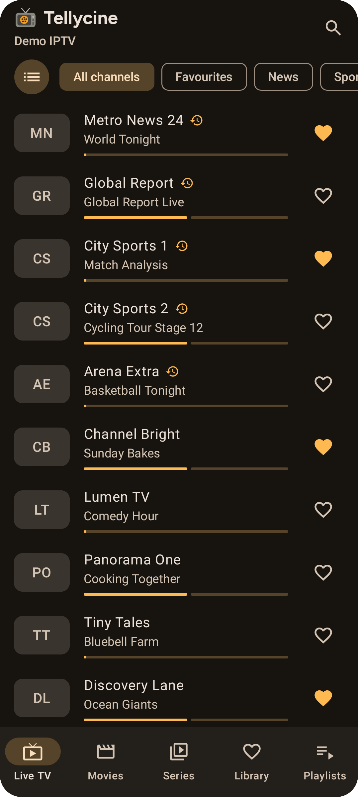
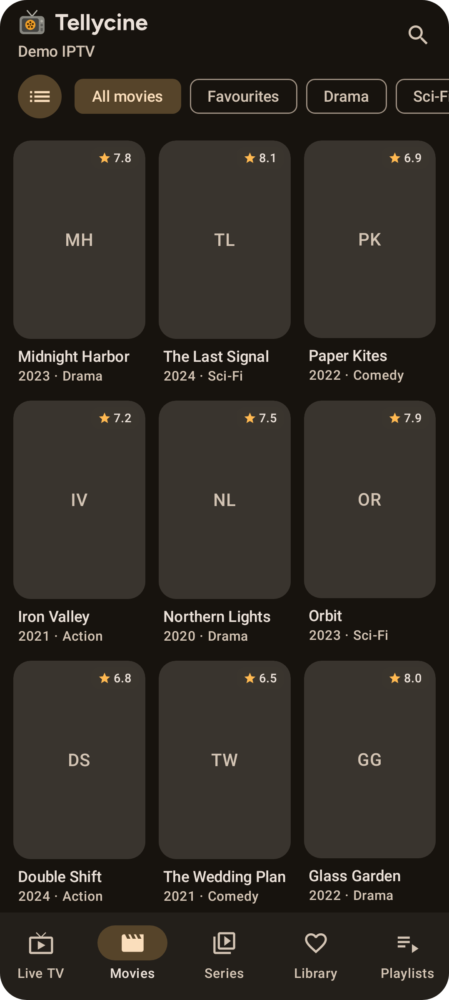
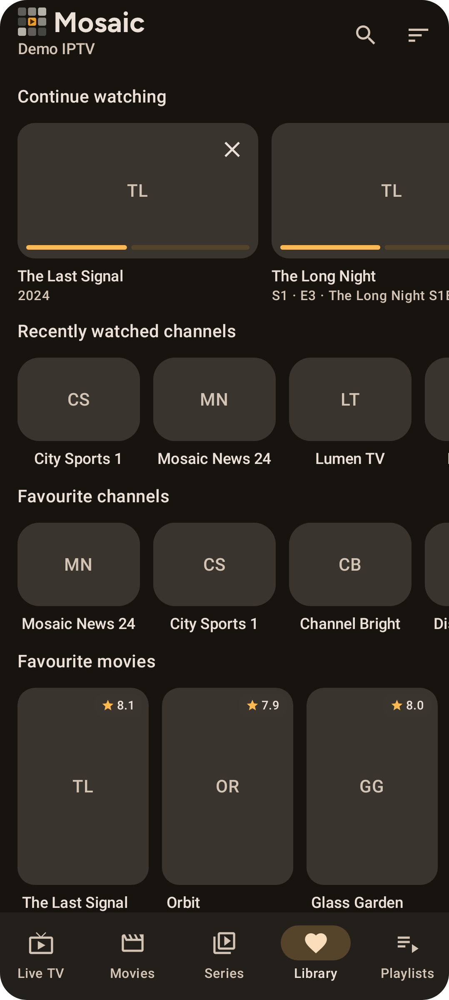

# Mosaic documentation

  
  
  

Mosaic is an IPTV player for Android phones and tablets. It plays your own M3U playlists, Xtream Codes accounts and Dispatcharr servers, with a TV guide, catch-up, recordings, offline downloads and Chromecast, in a clean Material 3 design.

> Mosaic is a player only. It doesn't provide any channels or content; you add playlists from your own provider.

## Getting started
- [Installation](Installation.md): download, install and update the app
- [Adding playlists](Adding-Playlists.md): M3U links, files, Xtream Codes and Dispatcharr
- [Managing playlists](Managing-Playlists.md): refresh, switch, filter categories, turn off movies & series

## Using Mosaic
- [Live TV & TV guide](Live-TV.md)
- [Catch-up TV](Catch-up.md)
- [Movies & series](Movies-and-Series.md)
- [Library](Library.md): favourites, continue watching, sorting and grouping
- [Downloads](Downloads.md): save movies and episodes to watch offline
- [Search](Search.md)
- [Player](Player.md): controls, channel switching, picture-in-picture, external players
- [Chromecast](Chromecast.md)
- [Dispatcharr](Dispatcharr.md): recordings and source URLs
- [Settings](Settings.md)

## Help
- [Troubleshooting](Troubleshooting.md)
- [Privacy](Privacy.md)

## For developers
- [Development](Development.md): building, architecture, releases and signing
