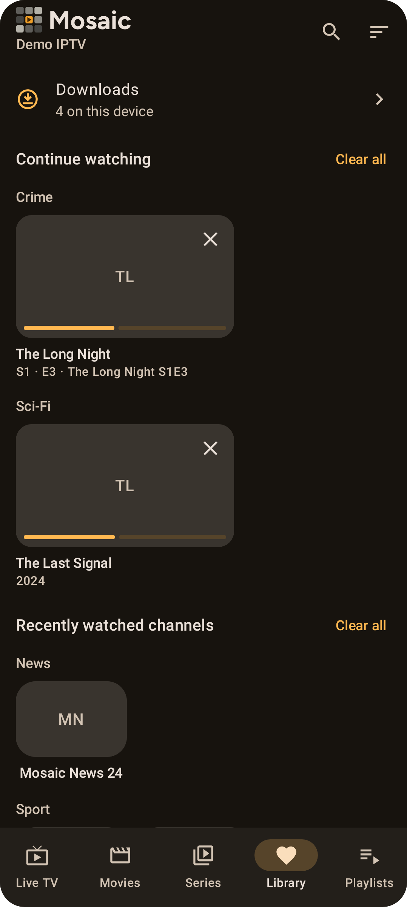
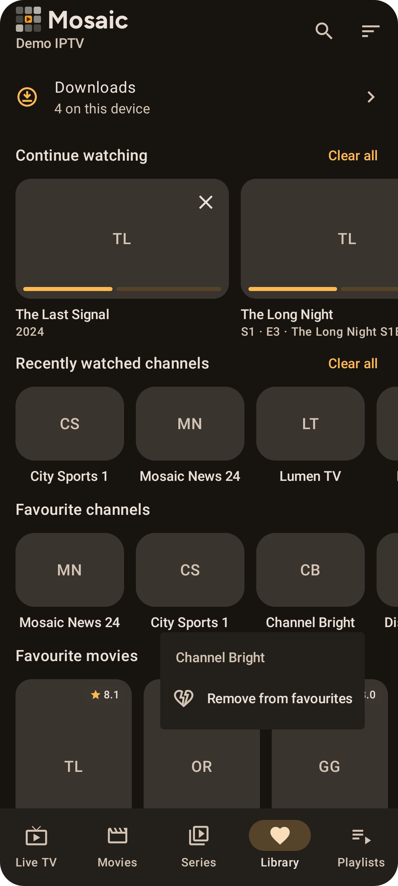

# Library

The **Library** tab collects what you watch most.

  
  

## Sections
- **Downloads:** shown once you've downloaded something. See [Downloads](Downloads.md).
- **Recordings:** shown for Dispatcharr playlists. See [Dispatcharr](Dispatcharr.md).
- **Continue watching:** movies and episodes you haven't finished.
- **Recently watched channels.**
- **Favourite channels**, **Favourite movies** and **Favourite series**.

## Removing items

- **One item:** long-press it and choose **Remove from favourites**, **Remove from recently watched** or **Remove from continue watching**, depending on the section. Continue watching cards also have an **×**.
- **Undo:** after removing an item, tap **Undo** in the message at the bottom of the screen to put it back.
- **Clear all:** **Continue watching** and **Recently watched channels** have a **Clear all** button. Mosaic asks you to confirm first. Clearing Continue watching forgets those resume points. Favourites, downloads and finished titles aren't affected.
- **Everything:** to wipe all watch history for every playlist, use **Settings → Clear watch history**.

## Sorting and grouping
Tap the sort icon in the top bar:
- **Sort by:**
  - **Most recent:** newest favourites first; history in the order you watched.
  - **Name (A–Z)** or **Name (Z–A)**.
  - **Playlist order:** channel number, then the playlist's own order.
- **Group by category:** shows one row per category in every section, in the playlist's category order. Items whose category is unknown go under "Other".

Mosaic remembers your choice.
