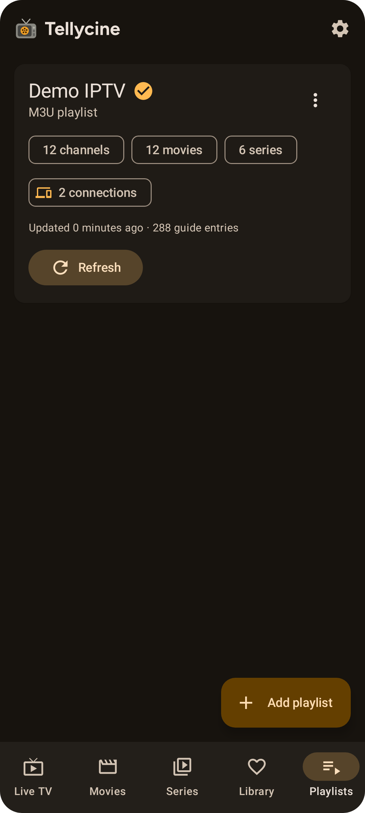
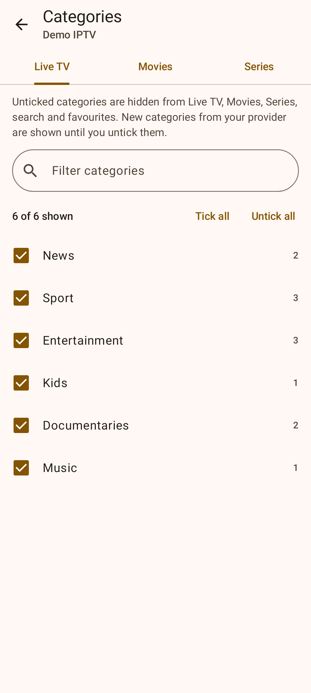

# Managing playlists

Each playlist card shows:
- the playlist type
- how many channels, movies and series it has
- when it was last updated
- how many guide entries are stored
- the account expiry date, for Xtream accounts

## Switching playlists
With more than one playlist, tap the playlist name under the Mosaic logo on the Live TV, Movies, Series or Library tab to switch. You can also tap **Use this playlist** on a card. Each tab shows the active playlist.

## Refreshing
- **Refresh** reloads the playlist and its TV guide. **Stop** cancels a refresh in progress.
- **⋮ → Update TV guide only** reloads just the guide.
- **Automatic refresh:** when the app starts, playlists older than a day and guides older than 12 hours are refreshed. You can turn this off in [Settings](Settings.md).

A refresh replaces the playlist in a single step. You keep seeing the old channels until the new ones are ready, and a failed refresh never leaves a half-empty playlist.

## Choosing categories to show
Open **⋮ → Categories**, or **Choose categories to show** in the playlist editor.

- **Separate tabs** for Live TV, Movies and Series.
- **Ticking:** untick a category to hide it everywhere in that playlist: browsing, "All", search, favourites and channel switching in the player.
- **Filter box:** narrows the list. **Tick all** and **Untick all** then apply to the matching categories, for example everything containing "Arabic".
- **No refresh needed:** changes apply instantly, and your choices survive refreshes.
- **New categories** your provider adds later start ticked.

## Editing and deleting
- **⋮ → Edit:** change the address, login, guide URL, user agent or the Movies & series switch. Saving reloads the playlist.
- **⋮ → Delete:** removes the playlist with its channels, guide, favourites and watch history from your device.
