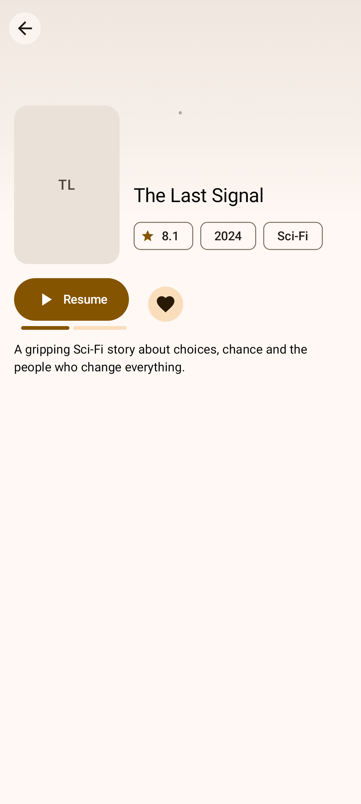
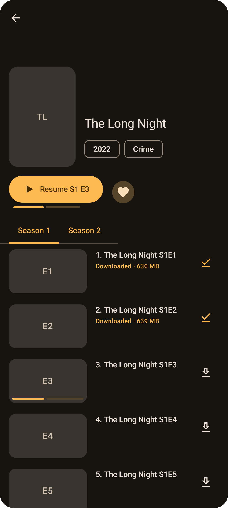
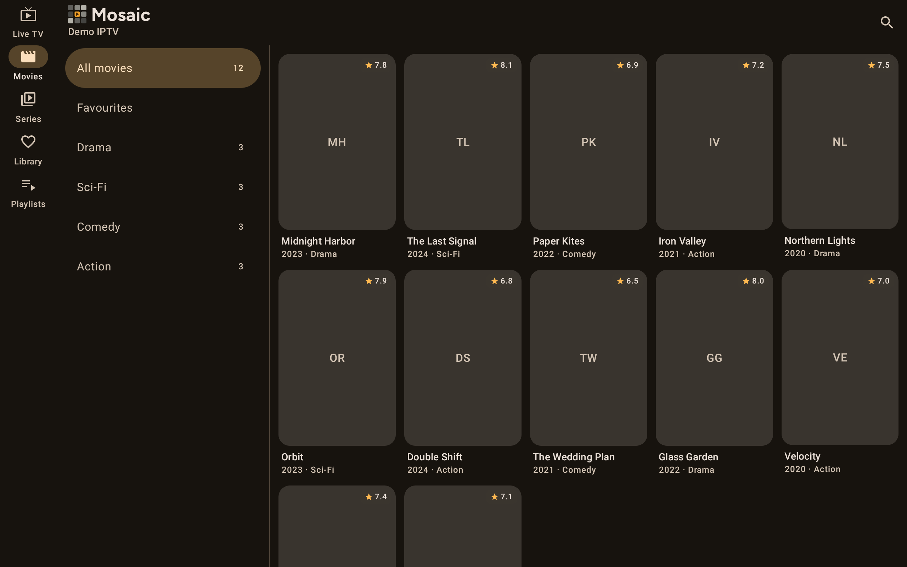

# Movies & series

  
  
  

## Browsing
- **Layout:** the **Movies** and **Series** tabs show poster grids by category, the same way as [Live TV](Live-TV.md). On tablets, categories are in a side pane.
- **Posters** show the title, year, genre and rating.
- **Hidden tabs:** if a playlist has [movies & series turned off](Managing-Playlists.md), these tabs are hidden.
- **Playlists:** with more than one playlist, the button before the categories chooses **All playlists** or one of them, separately for Movies and for Series. Together, each poster shows the playlist it's from, and a title's page always says which playlist it's from. See [Switching playlists](Managing-Playlists.md#switching-playlists).
- **Sort:** the sort button (at the top of the screen; on a TV, beside the category button) puts titles in another order. Movies and Series each remember their own:
  - **Provider order:** as your provider lists them.
  - **Date added:** newest first. Xtream Codes providers say when they added each movie; otherwise (M3U playlists, and most series) it's when Tellycine first saw the title, so after the first import, new arrivals come to the top.
  - **Release date:** newest first, from the provider's release date or year. In M3U playlists, a year in brackets in the title counts, as in "Film Name (2023)".
  - **Latest episode** (series): the series with the newest episodes first, from Xtream Codes providers.
  - **A–Z:** by title.

  Titles without the date sorted by come after the rest, in the provider's order.

## Details
Tap a poster to open its details: artwork, rating, year, length, genre, plot, director and cast. Xtream accounts load the extra details from the provider.
- **Artwork:** the title's backdrop fills the top of the page. When the provider has several, they take turns, fading from one to the next and slowly zooming in (unless **Remove animations** is on in Android's accessibility settings). Without a backdrop, a blurred copy of the poster is used instead.
- **Colours:** the page takes its colours from the artwork, keeping the app's light or dark look.
- **Play / Resume:** carries on where you stopped. A progress bar shows how far you got.
- **Heart:** adds the title to favourites.
- **Trailer** (film strip): opens the trailer in the YouTube app, when the provider has one.
- **Download:** saves the movie to your device to watch offline. See [Downloads](Downloads.md).

## Series
- **Seasons and episodes:** choose a season, then tap an episode. When the provider has season posters, the seasons are shown as posters; otherwise as tabs.
- **Main button:** offers the next episode to watch, or resumes the one you're part-way through.
- **Progress:** partly watched episodes show a progress bar.
- **Download:** each episode has its own download button. See [Downloads](Downloads.md).

Xtream accounts load seasons and episodes from the provider. For M3U playlists, Tellycine groups episodes into shows using the `S01E02` pattern in their names.
