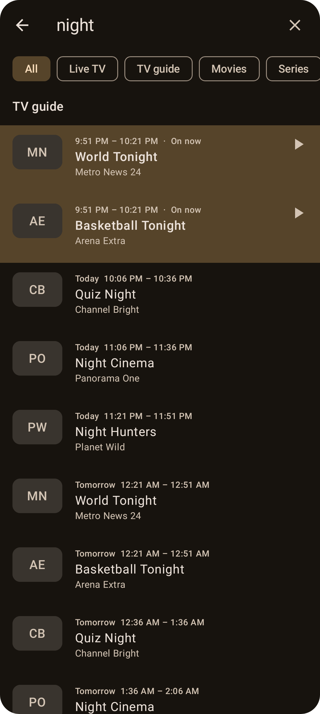

# Search

Tap the search icon in the top bar of the Live TV, Movies, Series or Library tab.

- **What it searches:** channel names, programme titles in the TV guide, and movie and series names in all your playlists. Type at least two letters.
- **Which playlist:** with more than one playlist, each result shows the playlist it's from, and the active playlist's results come first. A result plays or opens from its own playlist, without switching the active one.
- **Filters:** use the chips to search **All**, **Live TV**, **TV guide**, **Movies** or **Series**.
- **Results:**
  - Channels play straight away.
  - TV guide results show the programme, its time and channel, on now first, then upcoming, then past ones you can still [catch up](Catch-up.md) on. Tap one on now or upcoming to watch the channel live; tap a past one to replay it.
  - Movies and series open their details.
- **Hidden categories** are excluded. See [Managing playlists](Managing-Playlists.md).
