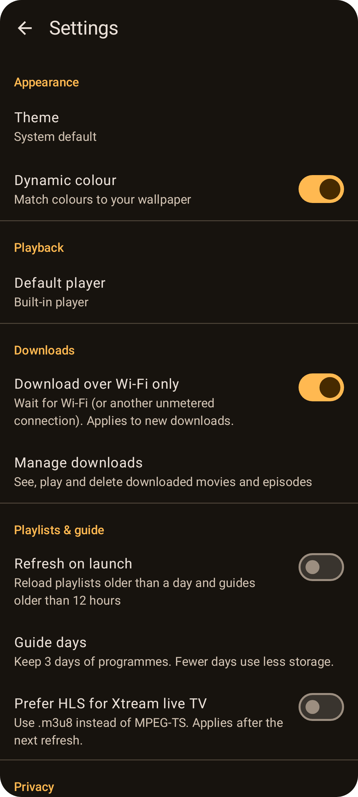

# Settings

Open **Playlists → ⚙ Settings**. On a TV, choose **Settings** in the side menu.

| Setting | What it does |
| --- | --- |
| **Theme** | System default, Light or Dark. |
| **Dynamic colour** | Matches colours to your wallpaper (Android 12+). When it's off, Tellycine uses its own amber palette. |
| **Default player** | **Built-in player**, or **External app** to hand all playback to another app. See [Player](Player.md). |
| **Download over Wi-Fi only** | Downloads wait for Wi-Fi or another unmetered connection. On by default. See [Downloads](Downloads.md). |
| **Manage downloads** | Opens the Downloads screen. |
| **Refresh on launch** | Reloads playlists older than a day and guides older than 12 hours when the app starts. |
| **Guide days** | How many days of upcoming programmes to keep (1, 2, 3, 5 or 7). Fewer days use less storage. |
| **Prefer HLS for Xtream live TV** | Use `.m3u8` instead of MPEG-TS for Xtream channels, where the provider allows it. Applies after the next refresh. |
| **Clear watch history** | Removes resume points and recently watched channels. |
| **Open on the last channel** | TV only: starts the channel you watched last when Tellycine opens. |
| **Match the TV's refresh rate** | TV only: switches the display to suit each video (for example 50 Hz for 25 and 50 fps channels). See [Android TV](Android-TV.md#tv-settings). |

On TV, **Theme** offers the TV's own colour themes instead (see [Android TV](Android-TV.md#tv-settings)), all of them dark, and **Dynamic colour** isn't offered.
