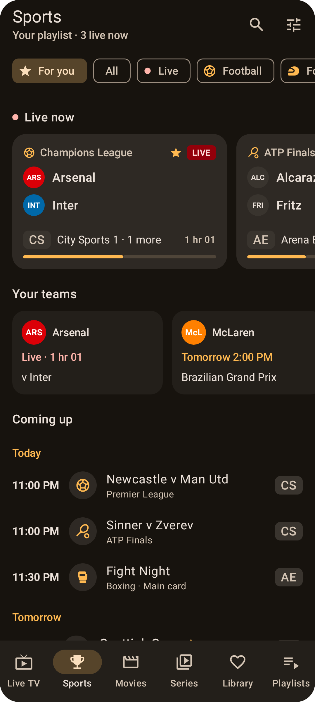
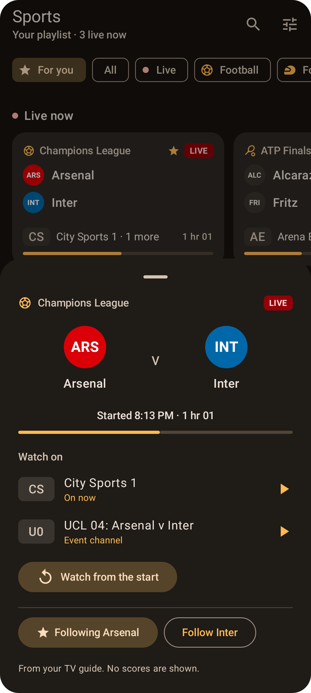
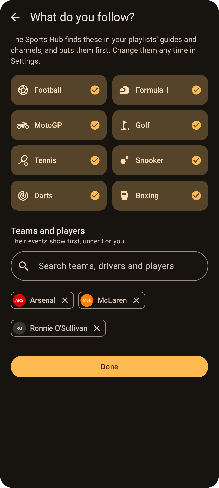
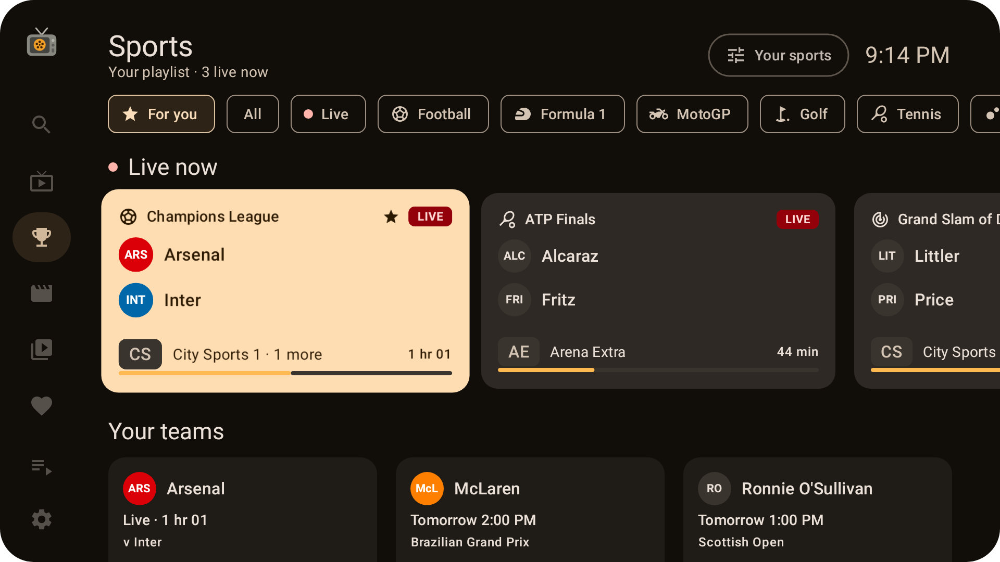
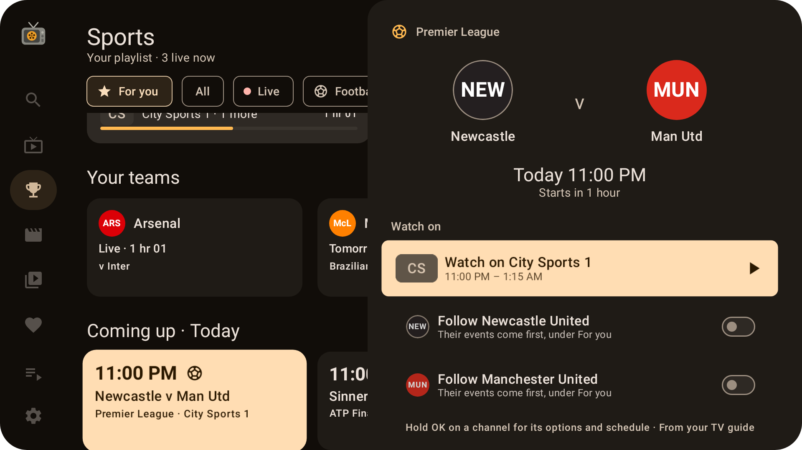

# Sports Hub

The **Sports** tab shows the sport on now and coming up in your playlists: football, Formula 1, MotoGP, golf, tennis, snooker, darts and boxing, and any other sport your TV guides call sport. On a TV, it's **Sports** in the side menu.

  
  
  

## What it shows
- **Filters** along the top: **For you** (the sports you follow, and your teams and players), **All** (every sport found, other sports too), **Live** (what your TV guides say is live, now and to come, in every sport), and one for each sport you follow.
- **Countries and competitions:** in a sport, a second row chooses between the competitions on, such as **Premier League**, **Champions League** or **LaLiga**, and a country with more than one, such as **England** for all of its. Football goes by country, UK first; tennis, golf, darts and snooker by tour and event.
- **Live now:** what's on now, with how long it's been on and the channel it's on ("City Sports 1 · 2 more" when it's on more than one).
- **Your teams:** each team or player you follow, with their next event in your guides.
- **Coming up:** what's on later, day by day, as far ahead as your TV guides go.

Tap an event to see where to watch it:
- **Watch on:** every channel it's on, in all your playlists, with the playlist's name when you have more than one. Tap one to watch it.
- **Watch from the start:** when it's started already and the channel has [catch-up](Catch-up.md).
- **Follow** either side, or stop following them.

No scores or results are shown, so nothing is spoiled.

## What do you follow?
Tap the **⚙ sliders** at the top of the Sports tab, or go to **Settings → Your sports and teams**:
- **Sports:** tick the ones you want under **For you**, each with its own filter. Untick one and its events still show under **All**.
- **Teams and players:** type a name. Tellycine suggests the teams, drivers and players it knows (from the Premier League, the EFL and Scotland to the F1 grid, the snooker and darts tours, tennis, golf and boxing), and names it has found in your guides. Anything else is found by name in titles and descriptions.

Following an F1 or MotoGP team or driver follows their sport's races, as they're in every one. Teams show in their colours with a three-letter code, as crests belong to the clubs.

## Where the sport comes from
Everything comes from your own playlists, on your device:
- **TV guides:** each programme's title, categories and description, and the channel it's on. "Live Premier League: Arsenal v Chelsea" on a sports channel is a live football match between Arsenal and Chelsea; "Football Focus" is a magazine show, which isn't shown; "Match of the Day" is highlights.
- **Live or not:** Sky Sports, TNT Sports and Premier Sports say "Live" on their live coverage, so on their channels, sport that doesn't say it (such as "The Emirates FA Cup" or "EFL 26/27: West Brom v Millwall") is taken to be shown again. A season or past year in the title, "Hlts" and the like mark replays and highlights anywhere.
- **Event channels:** many providers have channels whose names change with each event, such as "EPL 03: Arsenal v Chelsea 15:00", "PPV 1 | Joshua v Dubois | Sat 22:00 UK" or "Sky Sports + 05: EFL Trophy Barnet v L Orient @ 10 Nov 06:45 PM London". Their events show too, and join the same match on other channels. Times without a time zone are taken to be UK time.

The same match on several channels, or in several playlists, is one event with every channel it's on.

Episodes of series ("S05 E12"), films, and radio and music channels aren't taken for sport, whatever they're called: The Simpsons' "Tennis the Menace" isn't tennis. On a sports channel, a series is a magazine or documentary, and stays out too.

Sport is found after each refresh of a playlist or its guide, in the background. Only what's new in the guide is looked through again.

### Getting the best results
- Guides that give programmes **categories** (such as "Sport, Football") work best.
- Tellycine knows UK names first: the BBC, ITV, Sky Sports, TNT Sports, Premier Sports and the like, and how UK guides name events. Guides from elsewhere work too, but may be found less well.
- Replays and highlights are hidden unless you turn on **Replays and highlights** in Settings.

## Settings
In **Settings → Sports** (on phones and TV):

| Setting | What it does |
| --- | --- |
| **Sports Hub** | The Sports tab, and Sports in the TV menu. On by default. Turning it off also stops looking for sport, and forgets what was found. |
| **Your sports and teams** | What shows under **For you**. |
| **Replays and highlights** | Shows them as well as live coverage. Off by default. |
| **Event channels** | Shows the events channels' names announce. On by default. |
| **Sport found** | For each playlist, how much sport was found in its guide and when, or why its guide couldn't be looked through. **Look again** looks through every guide afresh. |

### If the Sports tab is empty
The empty Sports tab, and **Settings → Sports → Sport found**, say what was found in each playlist's guide. If a playlist hasn't been looked through yet, or its guide couldn't be, use **Look again**. Sport is found on each device separately, from its own copy of your guides, so one device can be behind another until its guide is refreshed.

## On TV

- Rows of cards: **Live now**, **Your teams**, then each day's events.
- **OK** on a live event plays it. On one coming up, or held on a live one, it opens the event's panel: where to watch it, from the start, **Record** (where the playlist can record, as in the guide), **Multi-view** (when it's on now), and following its sides.
- **Hold OK** on a channel in the event's panel for that channel's options and schedule, as in the guide: favourites, Multi-view, Open with…, its stream URL, and watching or recording its programmes. **Back** returns to the event.
- **Your sports** at the top chooses what you follow.
- Back from a live channel, it plays on in a **mini player** at the top, as in the guide. OK on it, or **holding Back**, returns it to full screen; it stops when you leave Sports.
- **Back** goes to the filters, **Back** again opens the side menu, and **Back** from the menu asks whether to leave Tellycine.

## Privacy
The Sports Hub sends nothing anywhere: it reads your playlists' guides and channel names on your device, and what you follow stays on it. See [Privacy](Privacy.md).
